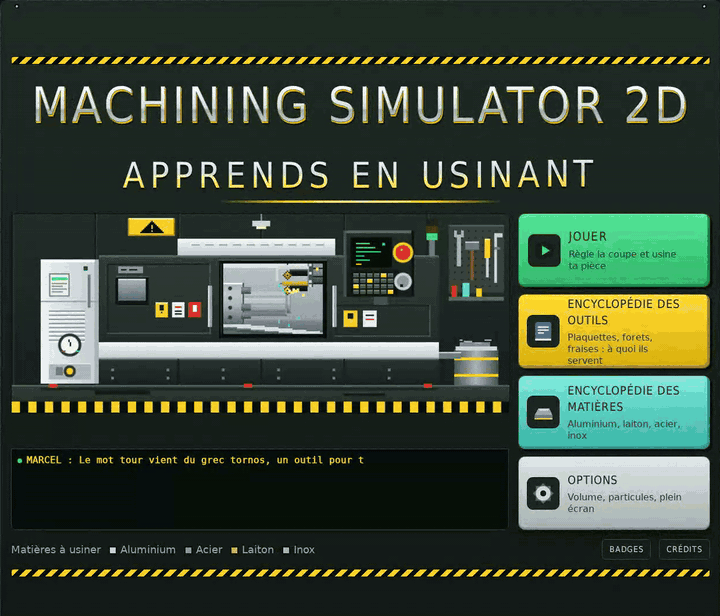
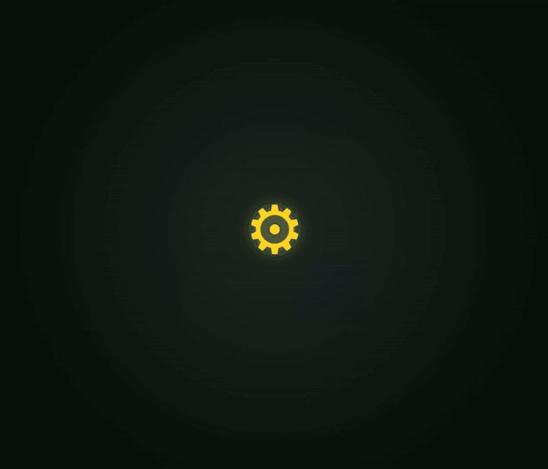
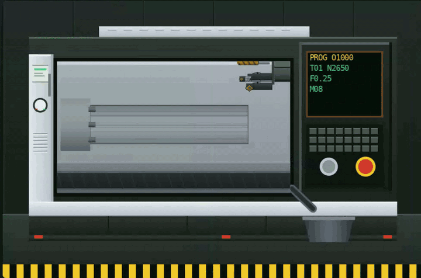
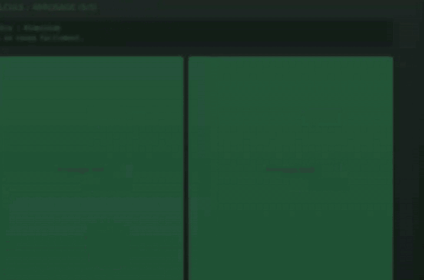
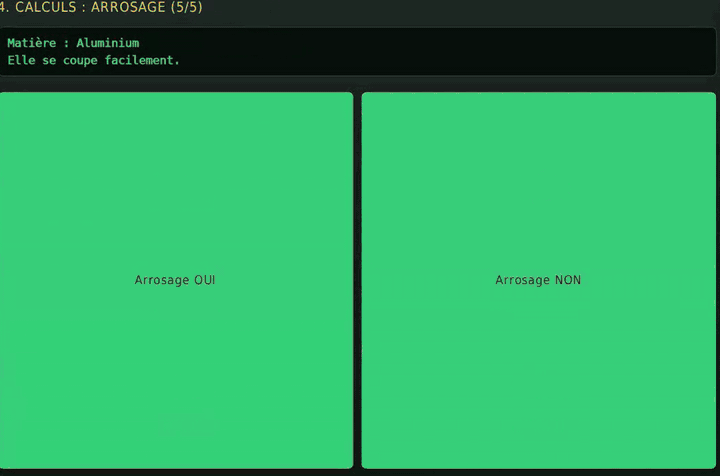

# Machining Simulator 2D

**Apprends en usinant.** Un jeu éducatif en 2D pour découvrir l'usinage de façon ludique, pensé pour les nouveaux arrivants en **Seconde Bac Pro Usinage**.

Tu règles la coupe, tu choisis la machine et les outils, tu fais tes calculs, puis tu lances le cycle et tu surveilles ta machine. Marcel, le chef d'atelier, te guide et commente chacun de tes choix. Si tu te trompes, ça se voit : surface rugueuse, outil cassé, machine détruite.

## Comment ça se joue

1. **La pièce** : observe le brut et la pièce finie.
2. **La machine** : tour ou fraiseuse ?
3. **Les outils** : choisis ceux qui conviennent à l'opération.
4. **Les calculs** : fréquence de broche, avance, profondeur de passe, nombre de passes, arrosage.
5. **L'usinage** : lance le cycle, garde la main près de l'arrêt d'urgence.

## Tournage et fraisage

6 niveaux, du simple arbre lisse au surfaçage d'une bride en inox.

## Et si on se trompe ?

Mauvaise machine, mauvais outil, avance trop forte : le jeu montre les conséquences. Un bon réflexe sur l'arrêt d'urgence peut éviter le pire.

## Aussi dans le jeu

- Une encyclopédie des outils (tour et fraiseuse) et une encyclopédie des matières
- Des étoiles, une note sur 7 et 9 badges à débloquer
- Des sons synthétisés, réglables dans les options

## Installer

1. Va dans l'onglet **Releases** de ce dépôt.
2. Télécharge `Machining Simulator 2D Setup x.x.x.exe` et lance-le.

Les mises à jour sont proposées directement dans le jeu : une notification apparaît quand une nouvelle version est publiée.

## Équipe

Projet réalisé au **Lycée Saint-Exupéry de Blagnac** par :
BELO DA SILVA Tomas, BENGHEZAL Lamine, GUETTAT Mohamed, METCHE Maxime.

## Avertissement

Jeu éducatif : les valeurs sont simplifiées et ne servent pas de référence de fabrication.

Alpha : attendez-vous à des bugs et des comportements bizarres.

© 2026. Licence : Tous droits réservés
